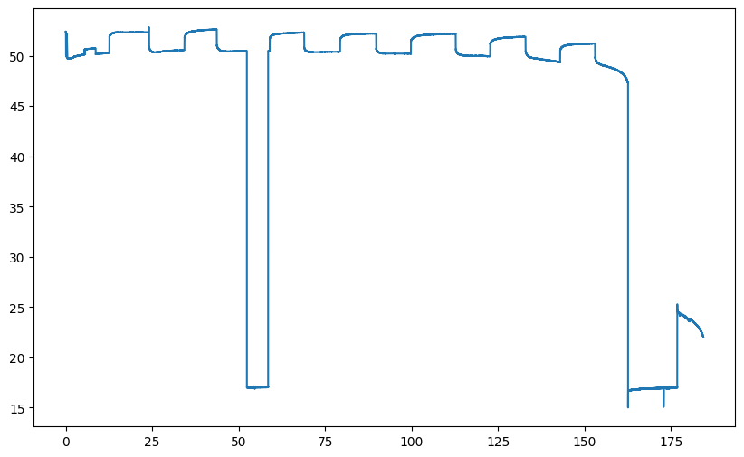
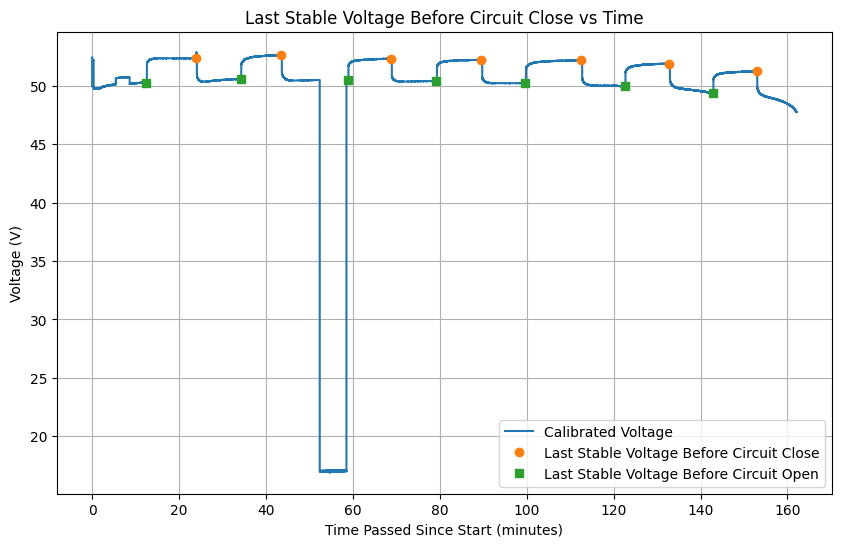
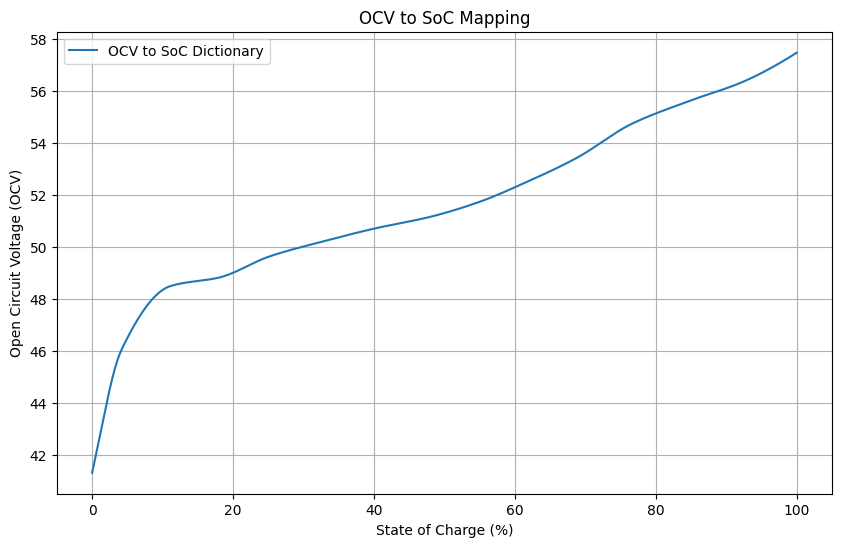
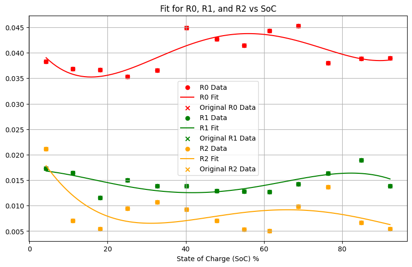
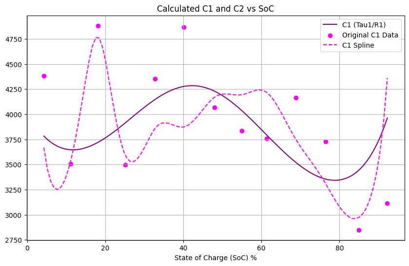

# Purpose

Obtain battery state to be used in Kalman filter for battery state estimation by measure the voltage and current of the battery at its terminal over time as it is discharging.

# Tables of Contents
1. [Requirements](#requirements)
    - [Hardware](#hardware)
    - [Software](#software)
2. [Data Aquisition](#data-aquisition)
    - [Warnings](#warnings)
3. [Voltage and Current Calibration](#voltage-and-current-calibration)
    - [Voltage](#voltage)
    - [Current](#current)
4. [How to use the Jupyter notebook](#how-to-use-the-jupyter-notebook)
5. [Sample inspection graphs](#sample-inspection-graphs)

# Requirements
## Hardware
- Battery to be tested
- ADC (ADS8688 or similar)
    - At least 2 channel (4 if the ADC will be used in the actual battery state estimation)
    - At least 12-bit resolution
    - At least 1kHz sampling rate
- Current sensor (Shunt resistor or Hall effect sensor)

## Software
- A computer
- Python 3.10 or higher
- Jupyter notebook or IDE that can run Jupyter notebook
- Dependencies specified in requirements.txt
    ```bash 
    pip install -r requirements.txt
    ```
- Excel or any spreadsheet software to view the csv file (Bonus if you can use Excel for sensor calibration)


# Data Aquisition
Battery dischare can be done on individual battery or on the entire array. Individual will require additional calculation to obtain the entire array state but the procedure is the same.

1. Ensure the battery is fully charged and rested for a few hours (preferrably a day) before starting the test.
2. Pick a suitable load / resistor to discharge the battery at a almost constant current (current draw will drop as voltage decreases). The load must be able to handle the power dissipation of the battery at its rated voltage and current. Make sure the load does not discharge the battery too fast. It should be able to discharge the battery for at least 10 cycles in step 7.
3. Data collected should be stored into a csv file with the columns: "**counter**", "**timediff_us**", "**ch0**", "**ch1**" (more channels can be added if needed).
    - Counter: Increase by 1 for each sample. It is used to check if any samples are missing.
    - Timediff_us: Time difference between the current sample and the previous sample in microseconds. It is used to check if the sampling rate is consistent.
    - ch0/1/2...: Raw ADC values from the channels. The number of channels depends on the ADC used. For example, ADS8688 has 8 channels, so it can measure 8 different signals at the same time.
4. Setup a simple discharge circuit -> Battery + -> Fuse -> Switch -> Resistive Load -> Battery - (Make sure the switch is rated for the current and voltage of the battery).
5. Connect a channel of the ADC to the battery terminal (Use a voltage divider if the battery voltage is too high)
6. Connect a different channel to a current sensor (Shunt resistor or Hall effect sensor) to measure the current flowing through the battery. Obtain a suitable current sensor that can handle up to 1.5 time max current output of the battery + output a voltage that is within the input range of the ADC (Use a lower rated sensor based on expected current draw of the load for higher resolution but might damage the sensor iff there is a surge/spike).
7. Discharge the battery in a constant cycle: 
    - Discharge for 10 minnutes
    - Rest for 15-20 minutes (Use a multimeter after 10 minutes to check if voltage is stable, less than 0.05V change per minute). **ADC should still be recording during the rest**.
    - Repeat until battery is fully discharged (BMS in the battery should cut off). Ensure that there are at least 10 cycles of discharge and rest.
    - Data should be stored in a csv file occationally to prevent data loss.

## Warnings
- Make sure a fuse is present and a switch is used. Both must be properly rated
    - Fuse: Stops the current from exceeding the rated current of the battery and causing damage to the battery or fire.
    - Switch: Allows the user to stop the current flow in case of emergency. Prevent unwanted arcing at high voltage.
- Make sure the load is properly rated for the battery voltage and current. If the load is not properly rated, fire.
- Make sure an extinguisher is nearby in case of fire and exit route properly planned. 


# Voltage and Current Calibration
Calibration can be done on excel curve fitting function as it is easier to do and faster to setup. Click two column, ADC raw value and voltage/current, plot a scatter graph and add a trendline. 

## Voltage 
1. During discharge test, seperately record voltage accross battery terminal using a multimeter and the ADC raw value. Do this accross the entire range of battery voltage (from fully charged to fully discharged). Record at least 10 points across the range.
2. Plot the multimeter voltage vs ADC raw value and fit a linear regression line to obtain the slope and intercept. Use this to convert ADC raw value to voltage.

## Current
As multimeter can only go up to 10A, 3 options are available: 
1. Use either a clamp meter to measure the current and replicate the voltage calibration (current draw will change as battery voltage drop) \
(Less accurate, more expensive)
2. Use a seperate discharge setup with a potentiometer to vary the current draw (0 - 10A) and a multimeter in series to measure the current \
(More accurate, but restricted to 10A)
3. Use a different and more accurate current sensor (shunt resistor) to avoid the need for calibration \
(Most accurate, but more expensive and more setup) 

# How to use the Jupyter notebook
The notebook is divided into 5 parts:
Run each of the notebook cell by cell and read the comments to understand what each cell does. The notebook is designed to be run in order, as each part depends on the previous part.

Some parts require manual inspection and modification of the code to remove outlier / choose curve fit.

1. Cleaner: Smooth the data and remove outliers. Convert ADC raw values to voltage and current using the calibration obtained above.
2. Parser: Obtain the data points of the resting curve of the battery by detecting circuit open and close
3. OCV-SOC Curve Fit: Select the smoothest piecewise fit graph visually and obtain the OCV-SOC curve fit. This is used to obtain the SOC of the battery from the OCV.
4. R-C Curve Fit: For each of the following: R, C, Tau, select the equation that best fits the data. 
5. EKF Constant: Dynamically obtain sigma values for the EKF based on deviation of the obtained dataset. 

Battery state will be recorded in a csv file, ranging from SoC of 0 - 1, with the columns: "SoC", "OCV", "R0", "R1", "R2", "C1", "C2", "Tau1", "Tau2". Interval between each row can be adjusted with "FACTOR" in rc-curve-fit.ipynb.

Fit function can be used instead of generating a dataset for each of the battery state but a look up table is used for its easier implementation and O(1) lookup time complexity.

# Sample inspection graphs

Raw Discharge Graph:


Resting Curve Detection:


SOC-Circuit Open/Close Detection:


SOC-OCV Curve Fit:


R-C Curve Fit:


